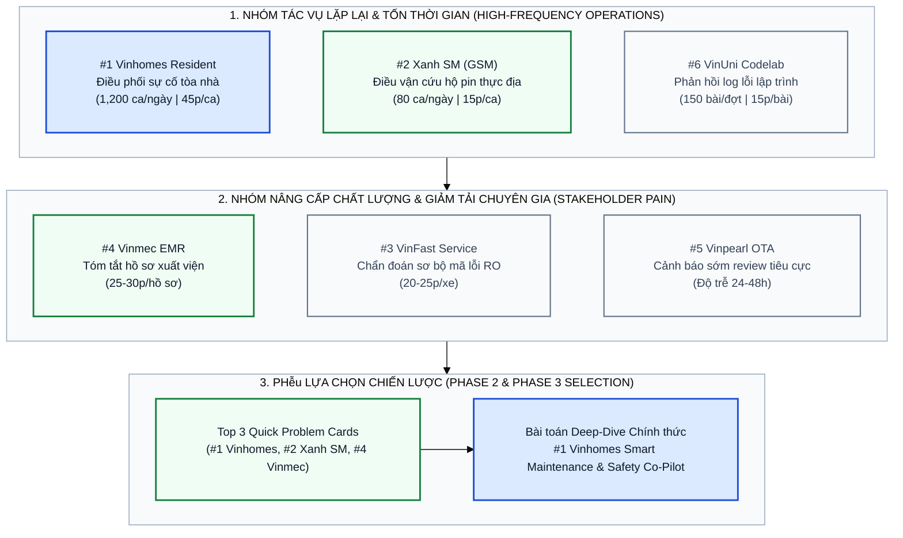

<div align="center">

<a href="#readme"></a>

# Khảo Sát Điểm Nghẽn Vận Hành & Đánh Giá Nhanh Cơ Hội AI

**Báo cáo Phân tích Giai đoạn 1 (SCAN) và Giai đoạn 2 (QUICK-ASSESS) trong Hệ sinh thái Tập đoàn Vingroup**

[](https://github.com/xtraiter/VinUni_Codelab_Day02)
[](https://github.com/xtraiter/VinUni_Codelab_Day02)
[-334155?style=flat-square)](https://github.com/lesongthao)
[](#phase-2-quick-assess)

</div>

---

## <a name="metadata"></a> Thông Tin Học Viên & Nhóm Thực Hiện

| Hạng mục | Thông tin chi tiết |
| :--- | :--- |
| **Học viên thực hiện nhánh (`lesongthao`)** | **Lê Sông Thao** — MSSV: `2A202603534` — Email: `sirothao123@gmail.com` |
| **Lớp / Khóa huấn luyện** | `L3A-H209` — AI Practical Competency Program (VinUniversity) |
| **Repository Nhóm** | [`xtraiter/VinUni_Codelab_Day02`](https://github.com/xtraiter/VinUni_Codelab_Day02) |
| **Danh sách thành viên nhóm** | 1. **Nguyễn Văn Ba** (Trưởng nhóm — `@xtraiter`) — `tetutetua1@gmail.com`<br/>2. **Lê Sông Thao** (MSSV: `2A202603534` — `@lesongthao`) — `sirothao123@gmail.com`<br/>3. **Nguyễn Quang Duy** (MSSV: `2A202603462` — `@nduy120505`) — `nduy120505@gmail.com`<br/>4. **Thanh Lâm** (`@LysLama`) — `thanhlam211204@gmail.com`<br/>5. **Thành** (`@thanhntda`) |

---

## <a name="toc"></a> Mục Lục

1. [Thông Tin Học Viên & Nhóm Thực Hiện](#metadata)
2. [Phase 1 — SCAN: Quét Điểm Nghẽn Vận Hành Hệ Sinh Thái Vingroup](#phase-1-scan)
3. [Sơ Đồ Phân Tầng Cơ Hội AI Theo 4 Thấu Kính (4 Lenses)](#mermaid-scan)
4. [Phase 2 — QUICK-ASSESS: Ba Thẻ Bài Toán Trọng Điểm (Quick Problem Cards)](#phase-2-quick-assess)
   - [Card #1 — Vinhomes: Phân Loại & Điều Phối Xử Lý Sự Cố Kỹ Thuật Tòa Nhà](#card-1)
   - [Card #2 — Xanh SM (GSM): Điều Phối Trạm Sạc & Cứu Hộ Pin Thực Địa](#card-2)
   - [Card #3 — Vinmec: Trợ Lý Tổng Hợp & Soạn Thảo Hồ Sơ Xuất Viện](#card-3)
5. [Ma Trận So Sánh & Lựa Chọn Bài Toán Trọng Tâm Cho Phase 3](#selection-rationale)

---

## <a name="phase-1-scan"></a> 1. Phase 1 — SCAN: Quét Điểm Nghẽn Vận Hành Hệ Sinh Thái Vingroup

Áp dụng bộ khung phân tích **4 Lenses** (*Lặp lại — Repetitive*, *Tốn thời gian — Time-consuming*, *AI có thể tốt hơn — AI-upgrade*, và *Pain từ người khác — Stakeholder Pain*), bảng dưới đây tổng hợp 6 bài toán thực tế có tần suất lặp lại cao và gây rò rỉ hiệu suất vận hành rõ nét nhất tại 6 công ty thành viên của Vingroup.

### Danh Sách Bài Toán Vận Hành (6 Use Cases)

| # | Subsidiary (Công ty thành viên) | Lens (Thấu kính) | Mô tả ngắn bài toán & Điểm nghẽn vận hành (Operational Bottleneck) | Quy mô & Tổn thất ước tính (Google XYZ Baseline) |
| :-: | :--- | :--- | :--- | :--- |
| **1** | **Vinhomes** | **Lặp lại** *(Repetitive)* | **Phân loại và điều phối xử lý sự cố kỹ thuật tòa nhà từ App Vinhomes Resident:** Nhân viên CSKH trực Ban Quản lý phải đọc thủ công hàng nghìn phản ánh văn bản tự do (kèm viết tắt, không dấu) về điện, nước, thang máy, điều hòa, PCCC để xác minh và gán việc cho từng tổ kỹ thuật. | Phát sinh **~1,200 ticket/ngày** tại các đại đô thị; tiêu tốn **45 phút/ticket** (33 phút xử lý trung gian) và **~15% tỷ lệ gán nhầm** bộ phận kỹ thuật. |
| **2** | **Xanh SM (GSM)** | **Tốn thời gian** *(Time-consuming)* | **Điều phối xử lý sự cố pin yếu và cứu hộ năng lượng thực địa:** Điều phối viên phải tra cứu thủ công tọa độ GPS của xe báo sắp cạn pin, đối chiếu danh sách trụ sạc VinFast trống đúng chuẩn cổng sạc và gõ tin nhắn chỉ đường hoặc gọi xe cứu hộ pin khi pin dưới 5%. | Trung bình **~80 ca sự cố pin/ngày** tại Hà Nội và TP.HCM; mất **15 phút/lượt**, tiêu tốn **20 giờ công/ngày** của trung tâm điều vận giờ cao điểm. |
| **3** | **VinFast** | **AI có thể tốt hơn** *(AI-upgrade)* | **Chẩn đoán sơ bộ nhóm lỗi kỹ thuật từ mô tả ngôn ngữ tự nhiên của chủ xe:** Cố vấn dịch vụ tại xưởng phải đối chiếu mô tả cảm tính của khách hàng (tiếng kêu gầm xe, cảnh báo màn hình) với sổ tay kỹ thuật để phân luồng khoang sửa chữa. | Mất **20–25 phút/xe** ở khâu tiếp nhận; khoảng **18% trường hợp xếp lệch** giữa khoang Cơ khí và khoang Điện cao áp, làm ảnh hưởng cam kết thời gian giao xe (RO). |
| **4** | **Vinmec** | **Pain từ người khác** *(Stakeholder Pain)* | **Tổng hợp dữ liệu lâm sàng và soạn thảo tóm tắt hồ sơ xuất viện (Discharge Summary):** Bác sĩ nội trú phải mở nhiều phân hệ trên bệnh án điện tử (HIS/EMR) để sao chép kết quả xét nghiệm, chẩn đoán hình ảnh và đơn thuốc ra viện kèm hướng dẫn theo dõi tại nhà. | Bác sĩ mất **25–30 phút/bệnh nhân** cho thủ tục hành chính cuối ca trực; làm kéo dài thời gian chờ xuất viện của bệnh nhân và người nhà. |
| **5** | **Vinpearl** | **Pain từ người khác** *(Stakeholder Pain)* | **Phân tích đa ngôn ngữ và cảnh báo sớm phản hồi tiêu cực của khách lưu trú:** Nhân viên quản lý chất lượng phải đọc thủ công các đánh giá tiếng Việt, Anh, Hàn, Trung trên các kênh OTA (Booking, Agoda, Google Maps) để lọc ra sự cố dịch vụ khẩn cấp. | Độ trễ phát hiện phàn nàn nghiêm trọng kéo dài **24–48 giờ**, làm giảm khả năng can thiệp xử lý nóng ngay khi khách còn đang lưu trú tại resort. |
| **6** | **VinUni** | **Lặp lại** *(Repetitive)* | **Phân tích log lỗi lập trình và gợi ý hướng dẫn sư phạm cho sinh viên:** Giảng viên và trợ giảng (TA) phải đọc từng traceback lỗi cú pháp/logic để viết nhận xét hướng dẫn sinh viên tự sửa bài mà không đưa trực tiếp lời giải. | Tốn **10–15 phút/bài nộp**, tạo tải lớn khi quy mô lớp học thực hành lên tới **150–200 học viên/đợt**. |

---

## <a name="mermaid-scan"></a> 2. Sơ Đồ Phân Tầng Cơ Hội AI Theo 4 Thấu Kính (4 Lenses)



---

## <a name="phase-2-quick-assess"></a> 3. Phase 2 — QUICK-ASSESS: Ba Thẻ Bài Toán Trọng Điểm (Quick Problem Cards)

Từ 6 bài toán ở Phase 1, ba bài toán có tác động vận hành trực tiếp nhất (**#1 Vinhomes**, **#2 Xanh SM**, **#4 Vinmec**) được trích xuất để lập hồ sơ đánh giá nhanh (**Quick Problem Cards**).

---

### <a name="card-1"></a> 3.1. Card #1 — Vinhomes: Phân Loại & Điều Phối Xử Lý Sự Cố Kỹ Thuật Tòa Nhà (Được chọn Deep-Dive)

> [!IMPORTANT]
> **Mục tiêu chuẩn hóa theo công thức Google XYZ:** Đạt được mức giảm **94% thời gian xử lý trung gian** (từ **33 phút xuống dưới 2 phút/ticket**) và nâng độ chính xác phân luồng kỹ thuật lên **>= 95%**, bằng cách triển khai mô hình **Gemini 2.5 Flash** bóc tách thực thể tiếng Việt tự do kết hợp bộ quy tắc khóa an toàn (`[DRAFT_ONLY]` và lệnh JSON cứu hộ khẩn cấp).

```text
┌─────────────────────────────────────────────────────────────┐
│ QUICK PROBLEM CARD #1                                       │
│                                                             │
│ Bài toán (1 câu): Phân loại chuyên môn, mức độ khẩn cấp và  │
│ soạn lệnh điều phối kỹ thuật từ phản ánh của cư dân trên    │
│ App Vinhomes Resident.                                      │
│ Công ty thành viên: [ ] VinFast  [ ] Xanh SM  [x] Vinhomes  │
│                     [ ] Vinmec   [ ] Khác (Ghi rõ)________  │
│                                                             │
│ Ai đang đau (Actor)? Nhân viên CSKH trực tổng đài BQL,      │
│ Điều phối viên kỹ thuật tòa nhà, và Cư dân chờ xử lý sự cố. │
│                                                             │
│ Workflow thủ công hiện tại (5 bước):                        │
│   1. Cư dân gửi phản ánh văn bản tự do trên App (2p)        │
│   ──> 2. CSKH đọc ticket, gọi lại xác minh vị trí/lỗi (15p) │
│   ──> 3. Tra lịch ca trực, gán cho tổ kỹ thuật (10p)        │
│   ──> 4. Soạn tin nhắn chỉ dẫn & phiếu giao việc (8p)       │
│   ──> 5. Kỹ sư tòa nhà nhận việc và xuống căn hộ (10p)      │
│                                                             │
│ Bước nào tốn thời gian/lỗi nhất? Bước 2, 3 & 4 (⏱ 33 phút)  │
│ AI có thể nhảy vào hỗ trợ ở bước nào? Bước 2, 3 & 4         │
│ (Bóc tách vị trí/lỗi -> Phân loại tổ kỹ thuật -> Draft tin) │
│                                                             │
│ Đo thành công bằng gì (Metric có số)?                       │
│   Giảm thời gian phân loại & soạn điều phối từ 33 min       │
│   ──> dưới 2 min/ticket; độ chính xác phân luồng >= 95%.    │
│                                                             │
│ Quick Architecture: [ ] No AI  [ ] Rule  [x] LLM  [ ] Agent │
└─────────────────────────────────────────────────────────────┘
```

---

### <a name="card-2"></a> 3.2. Card #2 — Xanh SM (GSM): Điều Phối Trạm Sạc & Cứu Hộ Pin Thực Địa

> [!NOTE]
> **Mục tiêu chuẩn hóa theo công thức Google XYZ:** Rút ngắn **80% tổng thời gian điều phối sự cố pin** (từ **15 phút xuống dưới 3 phút/lượt**) và đảm bảo **0% trường hợp xe có mức pin `< 5%` bị điều hướng tới trạm sạc xa quá `5km`**, bằng cách tích hợp LLM Feature kiểm tra ngưỡng an toàn và tự động xuất lệnh điều xe sạc lưu động (`dispatch_mobile_charger`).

```text
┌─────────────────────────────────────────────────────────────┐
│ QUICK PROBLEM CARD #2                                       │
│                                                             │
│ Bài toán (1 câu): Hỗ trợ điều phối viên Xanh SM tra cứu     │
│ trạm sạc VinFast trống hoặc gọi xe cứu hộ pin di động khi   │
│ tài xế báo pin yếu giữa đường.                              │
│ Công ty thành viên: [ ] VinFast  [x] Xanh SM  [ ] Vinhomes  │
│                     [ ] Vinmec   [ ] Khác (Ghi rõ)________  │
│                                                             │
│ Ai đang đau (Actor)? Tài xế taxi điện (chờ đợi, mất cuốc),  │
│ Điều phối viên trung tâm điều vận (quá tải giờ cao điểm).   │
│                                                             │
│ Workflow thủ công hiện tại (5 bước):                        │
│   1. Tài xế gọi tổng đài báo xe sắp hết pin (2p)            │
│   ──> 2. Điều phối viên tra cứu tọa độ GPS xe (2p)          │
│   ──> 3. Tìm trạm sạc VinFast còn trụ trống phù hợp (5p)    │
│   ──> 4. Soạn tin nhắn chỉ đường gửi qua App tài xế (5p)    │
│   ──> 5. Gọi xe cứu hộ pin nếu pin dưới ngưỡng 5% (1p)      │
│                                                             │
│ Bước nào tốn thời gian/lỗi nhất? Bước 3 & 4 (⏱ 10 phút/lượt)│
│ AI có thể nhảy vào hỗ trợ ở bước nào? Bước 3, 4 & 5         │
│ (Đối chiếu % pin & khoảng cách -> Draft tin / Gọi cứu hộ)   │
│                                                             │
│ Đo thành công bằng gì (Metric có số)?                       │
│   Giảm thời gian xử lý sự cố từ 15 min ──> dưới 3 min/lượt; │
│   0% trường hợp chỉ dẫn xe pin < 5% đi trạm xa quá 5km.     │
│                                                             │
│ Quick Architecture: [ ] No AI  [ ] Rule  [x] LLM  [ ] Agent │
└─────────────────────────────────────────────────────────────┘
```

---

### <a name="card-3"></a> 3.3. Card #3 — Vinmec: Trợ Lý Tổng Hợp & Soạn Thảo Hồ Sơ Xuất Viện

> [!NOTE]
> **Mục tiêu chuẩn hóa theo công thức Google XYZ:** Giảm **83% thời gian bác sĩ soạn hồ sơ hành chính** (từ **30 phút xuống dưới 5 phút/ca**) với **100% văn bản có bước bác sĩ điều trị kiểm duyệt (HITL)**, bằng cách dùng LLM trích xuất kết quả xét nghiệm và đơn thuốc từ hệ thống EMR thành bản nháp `[DRAFT_ONLY]`.

```text
┌─────────────────────────────────────────────────────────────┐
│ QUICK PROBLEM CARD #3                                       │
│                                                             │
│ Bài toán (1 câu): Tổng hợp dữ liệu lâm sàng từ bệnh án điện │
│ tử (EMR) để soạn bản nháp tóm tắt hồ sơ xuất viện và hướng  │
│ dẫn chăm sóc tại nhà cho bệnh nhân Vinmec.                  │
│ Công ty thành viên: [ ] VinFast  [ ] Xanh SM  [ ] Vinhomes  │
│                     [x] Vinmec   [ ] Khác (Ghi rõ)________  │
│                                                             │
│ Ai đang đau (Actor)? Bác sĩ nội trú (quá tải thủ tục hành   │
│ chính), Bệnh nhân (chờ giấy ra viện lâu, khó hiểu thuật ngữ)│
│                                                             │
│ Workflow thủ công hiện tại (4 bước):                        │
│   1. Bác sĩ mở HIS/EMR đọc lại diễn tiến điều trị (8p)      │
│   ──> 2. Copy kết quả xét nghiệm và đơn thuốc ra viện (7p)  │
│   ──> 3. Gõ tay phần tóm tắt bệnh sử & dặn dò (12p)         │
│   ──> 4. Bác sĩ điều trị kiểm tra, ký duyệt và in (3p)      │
│                                                             │
│ Bước nào tốn thời gian/lỗi nhất? Bước 1, 2 & 3 (⏱ 27 phút)  │
│ AI có thể nhảy vào hỗ trợ ở bước nào? Bước 1, 2 & 3         │
│ (Trích xuất EMR -> Soạn bản nháp [DRAFT_ONLY] chờ bác sĩ ký)│
│                                                             │
│ Đo thành công bằng gì (Metric có số)?                       │
│   Giảm thời gian bác sĩ soạn hồ sơ từ 30 min ──> dưới 5 min;│
│   100% hồ sơ được bác sĩ kiểm tra và ký duyệt trước khi in. │
│                                                             │
│ Quick Architecture: [ ] No AI  [ ] Rule  [x] LLM  [ ] Agent │
└─────────────────────────────────────────────────────────────┘
```

---

## <a name="selection-rationale"></a> 4. Ma Trận So Sánh & Lựa Chọn Bài Toán Trọng Tâm Cho Phase 3

| Tiêu chí đánh giá | Card #1 — Vinhomes (Sự cố tòa nhà & đội xe nội khu) | Card #2 — Xanh SM (Sự cố sạc pin thực địa) | Card #3 — Vinmec (Tóm tắt hồ sơ xuất viện) |
| :--- | :--- | :--- | :--- |
| **Tần suất phát sinh** | **Rất cao (~1,200 ca/ngày)** | Trung bình (~80 ca/ngày) | Cao (~400 ca/ngày) |
| **Độ phức tạp ngôn ngữ (NLP Fit)** | **Cao:** Tiếng Việt tự do, viết tắt, không dấu, sự cố liên hoàn nhiều bộ phận. | **Trung bình:** Chủ yếu là tọa độ GPS, % pin và địa chỉ trụ sạc. | **Rất cao:** Thuật ngữ y khoa chuyên sâu, đòi hỏi chuẩn JCI/Bộ Y tế. |
| **Mức độ sẵn sàng dữ liệu Pilot** | **Sẵn sàng ngay:** Lịch sử ticket trên App Vinhomes Resident & log điều vận. | **Sẵn sàng ngay:** Log tổng đài điều vận GSM & API trụ sạc VinFast. | **Cần chuẩn bị thêm:** Quy định ẩn danh hóa dữ liệu y tế (HIPAA/PDPA). |
| **Quyết định lựa chọn** | **CHỌN DEEP-DIVE CHÍNH THỨC (Tích hợp chuẩn an toàn năng lượng của Card #2)** | Hợp nhất quy tắc an toàn `< 5%` pin vào hệ thống điều vận chung | Đưa vào lộ trình giai đoạn 2 sau khi hoàn tất ẩn danh hóa EMR |

<details>
<summary><strong>Xem chi tiết lập luận phản biện từ góc nhìn CFO & COO trước khi chốt bài toán</strong></summary>

1. **Hiệu quả đầu tư (CFO Perspective):** Bài toán #1 (kết hợp điều phối phương tiện dịch vụ nội khu của #2) giải quyết trực tiếp **660 giờ công xử lý thủ công mỗi ngày** trên toàn hệ thống đô thị Vinhomes, trong khi chi phí vận hành mô hình `gemini-2.5-flash` chỉ khoảng **2.50 USD/tháng** cho 36,000 tickets.
2. **Kiểm soát rủi ro vận hành (COO Perspective):** Ranh giới an toàn được định nghĩa tường minh bằng hai khóa kỹ thuật kiểm chứng được qua code (`[DRAFT_ONLY]` bắt buộc có người duyệt và lệnh JSON `dispatch_mobile_charger` khi pin `< 5%`), loại bỏ hoàn toàn rủi ro AI tự ý gửi thông báo sai cho cư dân hoặc điều hướng phương tiện cạn năng lượng đi xa quá 5km.

</details>
