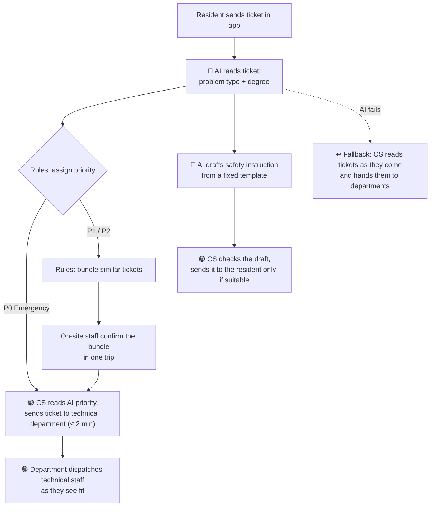

# 02 — Deep-Dive Report

> **Member:** Nguyễn Trường Thành (`thanhntda`)
> **Chosen problem (team-confirmed):** Vinhomes — sorting and dispatching building technical-incident tickets from the Vinhomes Resident app
> **Ground truth (team card):** ~1,200 tickets/day across the mega-urban areas; 45 min/ticket, of which 33 min is in steps 2–4; ~15% of tickets routed to the wrong technical team.
> **Note:** this is my personal draft. Where it differs from the team card, it is my own interpretation, for team discussion.

---

# Phase 3 — DEEP-DIVE

## 3.1. Current-State Workflow Mapping (G1 — 20 points)

Diagram: see `04-workflow-diagram.png`.

| Step | What happens | Who | Time | Handoff 🔄 / Bottleneck 🔴 |
|---|---|---|---|---|
| 1 | Resident sends a free-text incident report in the app | Resident | 2 min | 🔄 App → CS |
| 2 🔴 | CS reads the ticket and sends on-site staff to confirm the location and damage | CS + on-site staff | 15 min | 🔄 CS → on-site staff → CS |
| 3 🔴 | CS checks the shift schedule and assigns a technical team | CS | 10 min | 🔄 CS → technical team |
| 4 🔴 | CS writes the temporary safety instruction for the resident and the work order for the team | CS | 8 min | |
| 5 | Technical team receives the job and goes to the apartment | Technical team | 10 min | |

**Total = 45 minutes per ticket** (33 min in the bottleneck steps 2–4)

- **Main bottleneck — information relay:** every step is done by a different person, and each handoff means the same ticket is read and explained again.
- **Wrong-team loop (~15% of tickets):** the wrong team wastes time on a ticket that isn't theirs instead of their other tickets, CS has to reassign the correct team, and the resident keeps suffering while waiting for technical support.
- **Hidden pains today:**
  - **No priority:** tickets are handled first-come, first-served, so urgent ones wait behind minor ones.
  - **On-site staff travel ticket by ticket** to confirm damage, with no grouping by location.

> **Personal interpretation:** in my draft, step 2 verification is done by on-site staff checking the damage in person (instead of the team card's phone call-back), within the same 15 minutes.

## 3.2. Problem Statement (6-field) & Metrics (G2 — 20 points)

| Field | Details |
|---|---|
| **1. Actor / Operator** | **CS staff** at the building management board (main operator, handles every ticket daily); also on-site staff, technical teams, and residents waiting for help. |
| **2. Current Workflow** | Resident sends a free-text report in the app → CS reads it and sends on-site staff to confirm the damage → CS checks the shift schedule and assigns a technical team → CS writes the safety instruction and work order → the team goes to the apartment. 5 steps, 3 handoffs, ~45 min/ticket, first-come first-served. |
| **3. Bottleneck** | **Information relay in steps 2–4 (33 of 45 min):** each step is done by a different person, so the same ticket is read and explained again at every handoff. |
| **4. Business Impact** | • **Staff time:** 1,200 tickets/day × 33 min ≈ **660 staff-hours/day** on steps 2–4. • **Wrong-team loop:** ~15% × 1,200 ≈ **180 tickets/day** go to the wrong team; each one wastes that team's time and repeats at least step 3 (+10 min) → **≥ 30 extra staff-hours/day** *(estimate)*, while the resident keeps waiting. • **Urgent cases waiting:** with no priority, an urgent ticket (e.g. no water, can't cook) waits the same ~45 min as a minor one, and longer if it is routed to the wrong team. |
| **5. Success Metric** | 1. **Steps 2–4:** 33 min → **under 2 min/ticket** *(team card)*. 2. **Routing accuracy:** **≥ 95%** tickets assigned to the correct team *(team card)*. 3. **Urgent tickets reach a team within 2 min** of being received. 4. **On-site trips cut by 50%** through bundling tickets. |
| **6. Operational Boundary** | **AI may:** prioritize tickets based on defined rules; bundle tickets based on defined rules; draft safety instructions from a fixed template for CS. **AI must NEVER:** make the decision to dispatch a team on behalf of a human; message or answer residents directly. **Human must approve:** every dispatch decision; every message sent to a resident (CS sends AI drafts only when suitable). |

## 3.3. Future-State Flow & AI Fit (G3 — 10 points)

**AI Fit:** [x] Rule / State-Machine  [x] LLM Feature  [ ] Agentic Loop

**Why this level (Rule vs LLM vs Agent):**
- **LLM:** reads each free-text ticket and defines the type and degree of the problem.
- **Rule:** the defined priority levels and bundling rules below are applied on top of what the LLM extracted.
- **Not Agent:** AI never dispatches a team or contacts residents; humans make every dispatch decision.

**Priority levels** *(my examples, not a complete list)*:

| Level | Examples |
|---|---|
| **P0 — Emergency** | Fire, someone trapped in an elevator |
| **P1 — Basic necessities / access** | No water, no electricity, locked out because of a broken lock |
| **P2 — Lower priority** | Broken window, water leaking from a single pipe, car blocked by someone's reckless parking |

**Emergency detection rules** (catch P0 even if the LLM labels it wrong):
- **Keywords:** tickets with emergency keywords (e.g. fire, trapped in elevator) are labelled P0.
- **Multiple reports:** many tickets about the same emergency in the same place (e.g. several people reporting the same fire) are labelled P0.

**Bundling rules** (in order): same type of problem → within the same time window → same floor → same building, so on-site staff can confirm several tickets in one trip.

**Future-state flow:**

- 🔵 **AI Steps:**
  - Read the ticket and define the type and degree of the problem; rules then set priority and bundle P1/P2 tickets.
  - Draft the temporary safety instruction for the resident from a fixed template.
- 🟢 **Human Steps (HITL):**
  - CS reads the AI priority and sends the ticket to the technical department within 2 min; the department dispatches technical staff as they see fit.
  - CS checks the AI-drafted safety instruction and sends it only when they think it is suitable.
- ↩️ **Fallback:** when the AI fails, CS reads tickets as they come and hands them to departments (today's process).
- **Emergency fast lane:** P0 tickets skip bundling and the on-site check and go straight to CS for a quick dispatch handoff. Emergencies are not common, so this does not overload CS.

---

# Phase 5 — EVALUATE (G4 — 10 points)

### AI Readiness Checklist
1. [ ] **We have clean sample data/logs to test with?** — *Partially.* Vinhomes likely has past logs of tickets passed to the right team, but tickets are probably **not labelled with priority**.
2. [x] **The risk of AI mistakes is controlled (through HITL or Fallback)?** — The main risk is an emergency labelled wrong and taking too long. Emergencies are not common, and the design catches them through **keywords** and **how many tickets report the same emergency**: many tickets about the same place (e.g. several people reporting the same fire) is an easy emergency label. CS still reviews every dispatch, and the fallback is today's manual process.
3. [ ] **Stakeholders are ready to change the old workflow?** — *Unsure.* People who already work here may not be ready, but the faster workflow is real and saves them time. As a student, this is my guess and not verified.

### Final decision
[ ] **GO** — start building a narrow-scope prototype
[x] **NOT YET** — collect more data / set a baseline first
[ ] **NO-GO** — not feasible / rule-based is better

**Justification (based on technical and cost evidence):**
> The problem is worth solving: steps 2–4 cost about **660 staff-hours/day**, and ~15% of tickets go to the wrong team while urgent cases wait as long as minor ones. But the data needed to build and test the AI is not ready. Past logs show which team handled a ticket, but not its **priority**, and not reliably **whether it was dispatched correctly**. Without these labels, we cannot measure the ≥ 95% routing accuracy or check that emergencies are caught.
>
> **Next step:** collect more data on past tickets and label them with priority and whether they were correctly dispatched. With that baseline, the decision can be reviewed again for a narrow-scope GO.
